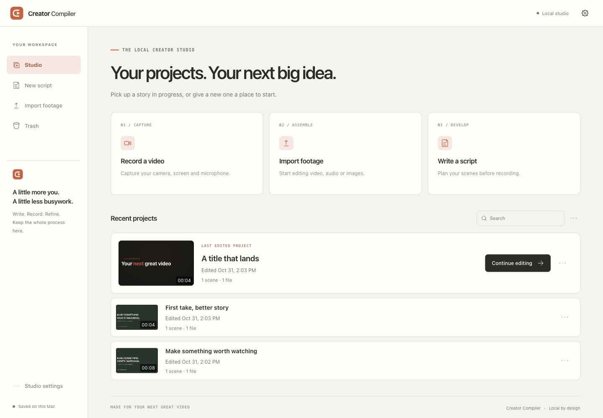
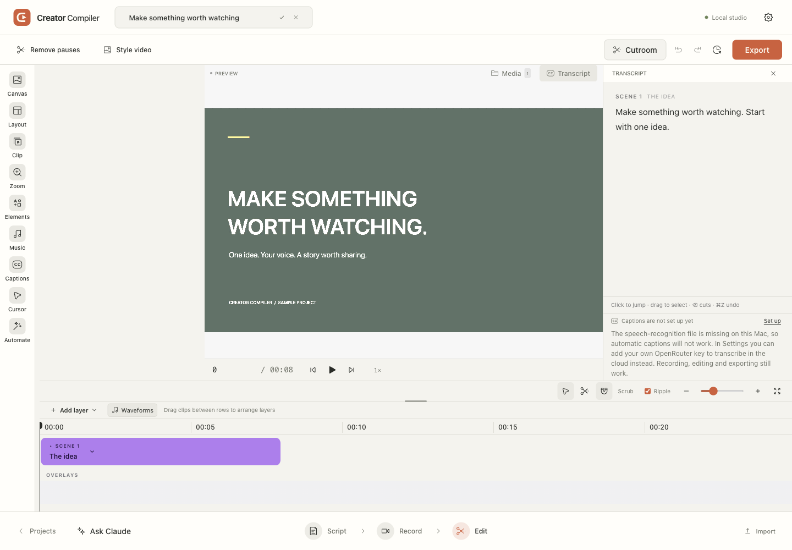
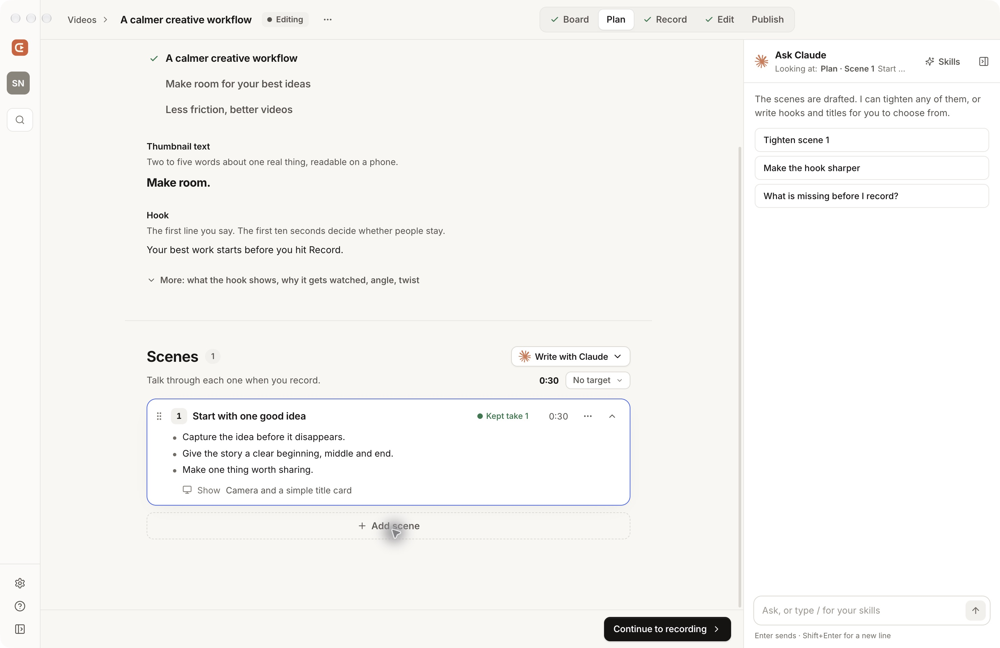
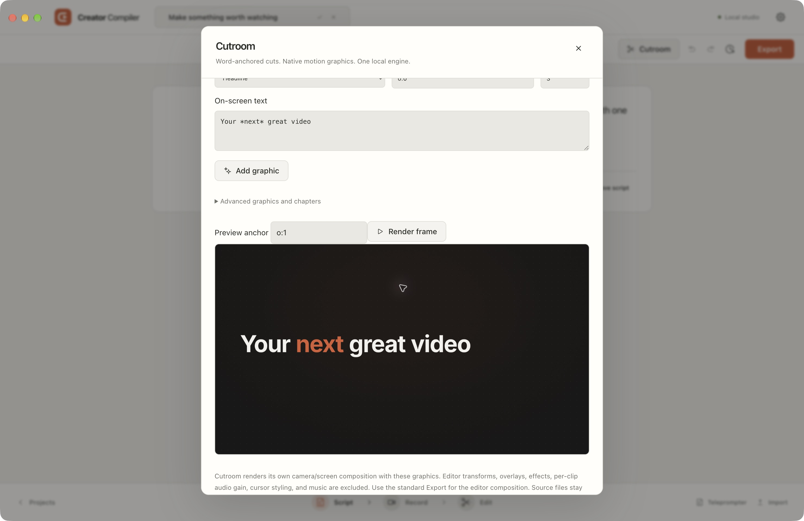

<p align="center"></p>
<h1 align="center">Creator Compiler</h1>
<p align="center"><strong>From first thought to final cut.</strong><br>A local desktop studio for writing, recording, and editing your next video.</p>
<p align="center">macOS desktop · Windows desktop · Rust editing engine · MCP</p>



Write your scenes, record your screen and camera, shape the timeline, and export. Cutroom runs alongside the editor to remove retakes and quiet gaps and render word-anchored motion graphics. Everything runs on your computer.

## Desktop apps

The app uses **Electron for the desktop window and device access**, **React for the interface**, and **Rust for Cutroom**. It runs as an installed desktop application. A local loopback service handles media; no hosted service or separate browser is required.

| Platform | Build output | Capture and rendering |
| --- | --- | --- |
| macOS 14+, Apple Silicon | `.app`, `.dmg`, `.zip` | Swift ScreenCaptureKit + Electron; native Rust graphics |
| Windows x64 | NSIS `.exe` installer and `.zip` | Electron screen/window, camera and microphone capture; native Rust graphics and resvg text rendering |

Both targets live in this repository. [Desktop apps](.github/workflows/desktop-build.yml) builds them on their target operating systems and saves installers as workflow artifacts. Development builds are not notarized or Windows publisher-signed releases. Hardware capture needs an on-device check on each platform.

## What works today

- **Plan a video:** a channel workspace, discovery and research boards, ideas, outlines, scripts, and a production pipeline.
- **Write:** scene scripts, scene ordering, teleprompter, and saved history.
- **Record:** screen/window, camera, microphone, takes, and recording review.
- **Edit:** a multi-track timeline, transcript cuts, captions, canvas layouts, and export.
- **Cut with Cutroom:** snapshot a video, detect cuts, review the proposal, and apply it with a revision check and a history checkpoint.
- **Make motion graphics:** choose a template, enter text, set a word or time anchor, preview a rendered frame, and export through Cutroom. Import the result as a new video.
- **Work with an assistant:** 47 MCP tools, including 8 Cutroom tools. Claude chat uses your separately installed Claude Code and existing sign-in.

Dani's redesigned workspace is the main interface: Home, Discover, Videos, and Research, with Plan, Record, Edit, and Publish inside each video. Publishing uses your separately configured Postiz connection. See [the workspace plan](docs/v2/PLAN.md).

In Edit, open **More → Cutroom cuts and graphics** for the native engine. Opening a Cutroom render creates a separate video in Editing and keeps the original video intact.

### The editor



### Write before you record



### Cutroom, in the app



Screenshots show the running application with synthetic sample footage, rather than private recordings.

## Run from source

Install Node.js 24, npm, Rust, and the platform's compiler tools: Xcode Command Line Tools on macOS, or Visual Studio Build Tools with Desktop development with C++ on Windows.

```sh
git clone https://github.com/AI-Answer/creatorclub.git
cd creatorclub
git switch main
npm run setup
npm run desktop
```

`setup` installs dependencies, builds the pinned Rust engine, and builds the interface and local service. For media operations in a source checkout, stage the bundled tools with `npm run runtime:desktop`. For interface development, `npm run dev` serves the editor at `http://127.0.0.1:4183` and its local service on port `4184`. The packaged desktop app uses `4194`, keeping it separate from the development service.

```sh
npm test                 # editor and service tests
npm run build            # renderer, service, native Mac helpers
npm run package:mac      # run on a Mac: app, DMG, ZIP
npm run package:win      # run on Windows: installer, ZIP
```

Installers bundle **Cutroom, FFmpeg, FFprobe, and fonts**. No Rust, Node, npm, or FFmpeg installation is needed on the end user's computer. Local speech transcription additionally needs Whisper and a compatible model. Privacy OCR needs Tesseract. These optional tools are not included in the new cross-platform installer recipe.

Source development stores recording projects in `recorder/app/.local/studio` and channel workspaces in `.local/channels`, with its own desktop profile. Installed apps use their platform application-data folder. Installed channel workspaces live in `~/Documents/Creator Compiler`; an existing `~/Documents/CreatorClub` workspace continues to be used when the new folder does not exist. `CREATORCLUB_DIR`, `SCENEFORGE_DATA_DIR`, and `SCENEFORGE_PORT` remain supported compatibility settings. Use separate workspace, data, and port settings for smoke tests.

## Connect through MCP

The source launcher starts or reuses the local service, then exposes the editor and Cutroom tools over stdio:

```sh
codex mcp add creator-compiler -- node /absolute/path/to/creatorclub/scripts/mcp.mjs
claude mcp add --scope user creator-compiler -- node /absolute/path/to/creatorclub/scripts/mcp.mjs
```

Start a new assistant session after adding it. The repository also includes [a development MCP configuration](.mcp.json), named `creator-compiler-dev`, which uses source-development data. The installed desktop app advertises its own native MCP launcher in **Settings → AI**.

Try: “Prepare a Cutroom snapshot of this project, detect cuts, show the proposal, and add a headline at the words ‘start with one idea’.” Applying cuts requires the exact reviewed revision. Rendering creates a separate output; importing it creates a new project.

[Cutroom workflow, tools, and boundaries](docs/CUTROOM.md) · [Desktop build details](docs/DESKTOP.md)

## Boundaries

Cutroom uses its own camera/screen composition. Editor transforms, effects, overlays, per-clip audio gain, cursor styling, and music are not carried into a Cutroom render; use the editor's standard Export for that composition. The bridge currently requires 1× source clips. Automatic cut detection requires word-timed captions. The form exposes common graphics; advanced JSON and MCP support the engine's full beat vocabulary.

macOS-only Apple Vision segmentation and face tracking remain unavailable on Windows. Regular recording, editing, standard text/shape export, and Cutroom graphics use portable paths. Windows hardware recording and installer acceptance are separate from successful compilation and CI startup.

## Source and licenses

The recorder/editor began as [SceneForge / CreatorCompiler](https://github.com/Samin12/CreatorCompiler). Its MIT-licensed implementation is in `recorder/`; historical documentation and release validation remain there. The new app has its own identity and data folder.

[Cutroom](https://github.com/AI-Answer/cutroom) is vendored under `engine/cutroom`, with its original license and a [pinned source revision](engine/CUTROOM-PROVENANCE.md). Inter and JetBrains Mono use the SIL Open Font License. FFmpeg is a separate GPL executable; runtime notices record its provider and source locations. See [LICENSE](LICENSE), [recorder notices](recorder/THIRD_PARTY_NOTICES.md), and [Cutroom's license](engine/cutroom/LICENSE).
