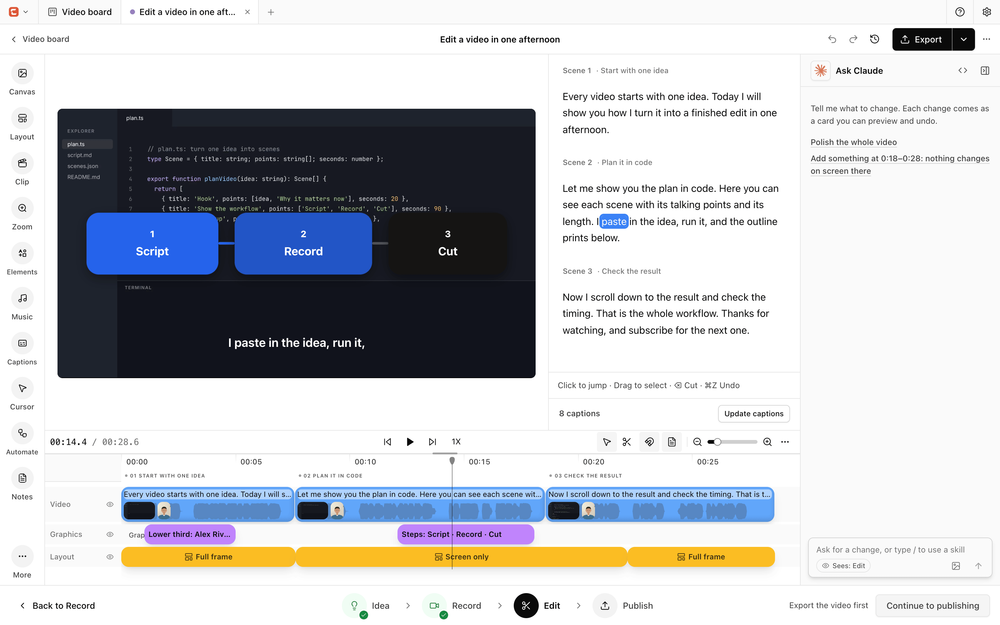
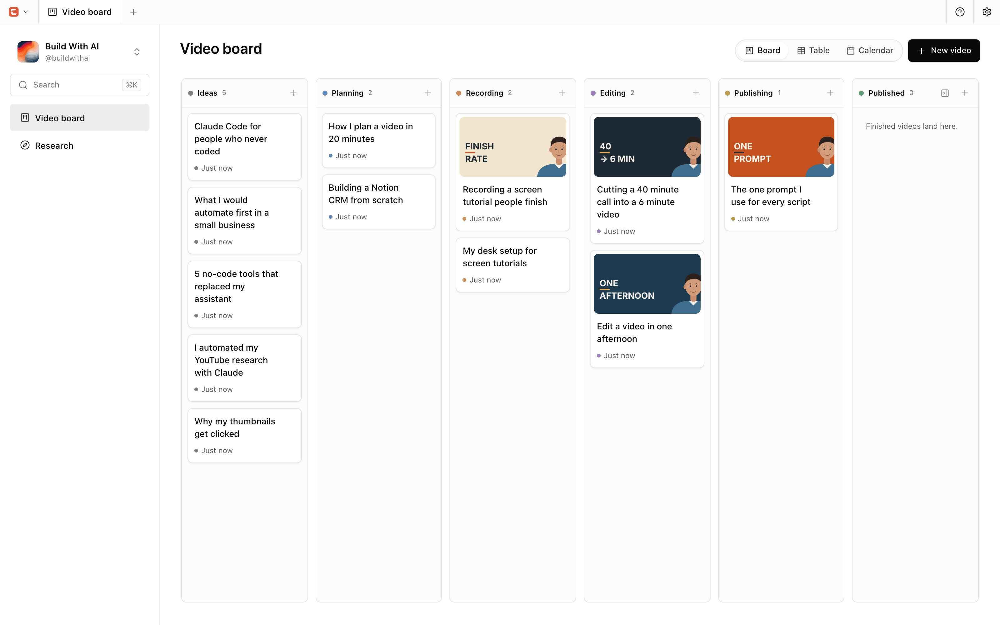
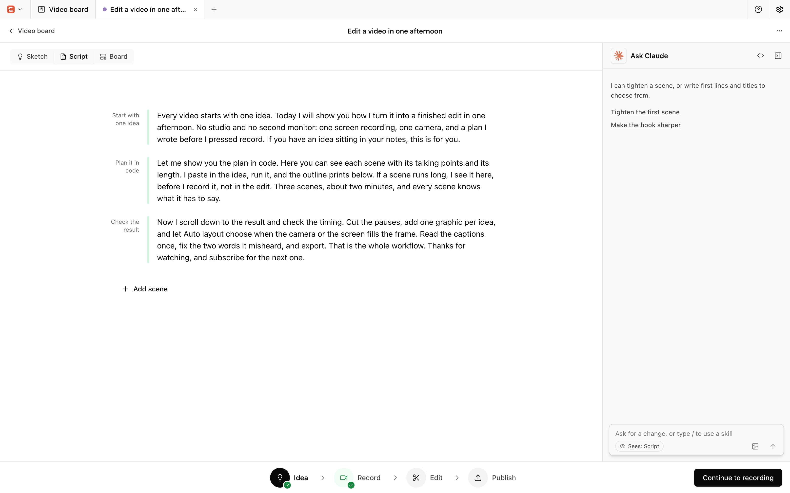
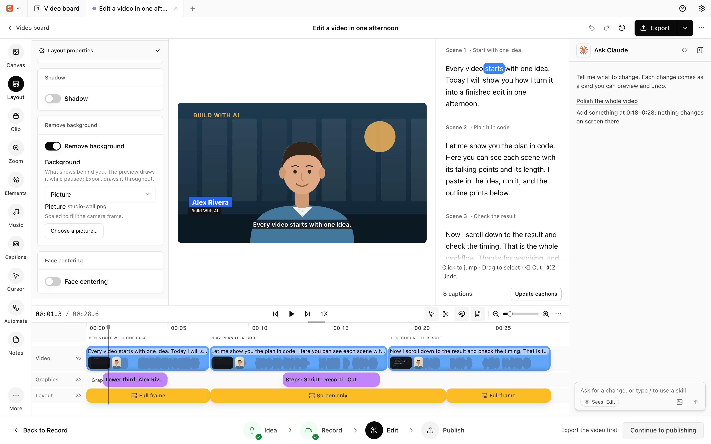
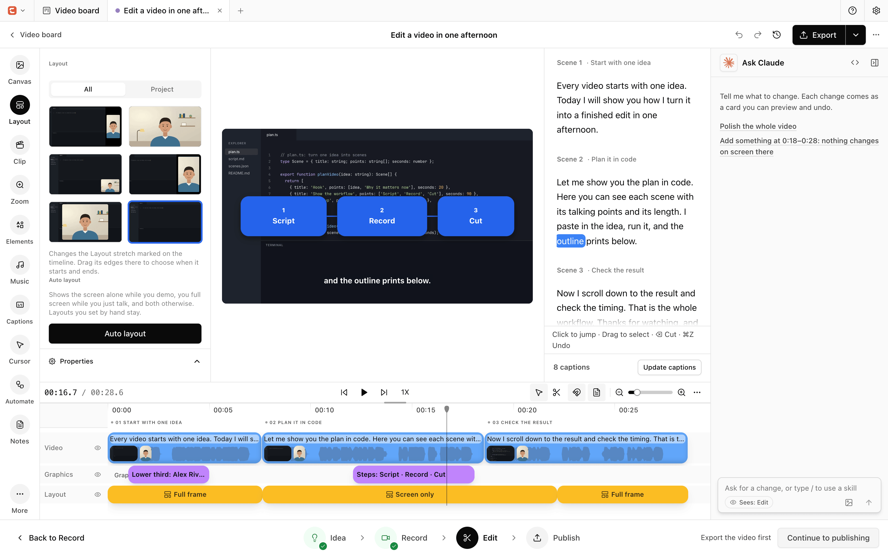
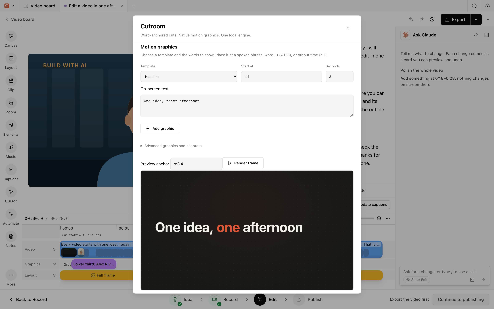

<h1 align="center">
  <picture>
    <source media="(prefers-color-scheme: dark)" srcset="docs/brand/logo-wordmark-dark.svg">
    
  </picture>
</h1>
<p align="center"><strong>From first thought to final cut.</strong><br>A local desktop studio for writing, recording, and editing your next video.</p>
<p align="center">For macOS and Windows, with a Rust editing engine and an MCP server.</p>



Write your scenes, record your screen and camera, shape the timeline, and export. Cutroom runs alongside the editor to remove retakes and silent gaps and render word-anchored motion graphics. Everything runs on your computer.

## Download

| | |
| --- | --- |
| **Mac** (Apple Silicon, macOS 14+) | [Download Creator-Compiler-mac-arm64.dmg](https://github.com/AI-Answer/creatorclub/releases/latest/download/Creator-Compiler-mac-arm64.dmg) |
| **Windows** (x64) | [Download Creator-Compiler-win-x64.exe](https://github.com/AI-Answer/creatorclub/releases/latest/download/Creator-Compiler-win-x64.exe) |

These links always get the newest build. Older versions and release notes are on the [releases page](https://github.com/AI-Answer/creatorclub/releases). Installed apps update themselves when you quit them.

The Mac app isn't notarized yet, so macOS stops it the first time you open it.
Right-click the app and choose **Open** (macOS 14), or go to **System Settings → Privacy & Security** and click **Open Anyway** (macOS 15 and later). On Windows, click **More info → Run anyway**.

## Desktop apps

The app uses **Electron for the desktop window and device access**, **React for the interface**, and **Rust for Cutroom**. It runs as an installed desktop application. A local loopback service handles media; no hosted service or separate browser is required.

| Platform | Build output | Capture and rendering |
| --- | --- | --- |
| macOS 14+, Apple Silicon | `.app`, `.dmg`, `.zip` | Swift ScreenCaptureKit + Electron; native Rust graphics |
| Windows x64 | NSIS `.exe` installer and `.zip` | Electron screen/window, camera and microphone capture; native Rust graphics and resvg text rendering |

Both targets live in this repository. [Desktop apps](.github/workflows/desktop-build.yml) builds them on their target operating systems and saves installers as workflow artifacts. Development builds are not notarized or Windows publisher-signed releases. Hardware capture needs an on-device check on each platform.

## What works today

- **Plan a video:** a channel workspace, Research, ideas, a one-page sketch, outlines, scripts, and the video board.
- **Write:** scene scripts, scene ordering, teleprompter, and saved history.
- **Record:** screen/window, camera, microphone, takes, and recording review.
- **Edit:** a multi-track timeline, transcript cuts, captions, animated graphics, canvas layouts, and export.
- **Greenscreen backgrounds (Mac only):** Remove background cuts you out of the camera with Apple Vision, no green screen needed. Behind you it can put a colour, a picture, a muted looping video, the screen recording playing at that moment, or a blur. Find it in Edit under Layout, then Properties. Each camera clip keeps its own background, so a split clip or a Layout stretch can have a different one. The preview shows the background while paused; while playing you see the plain camera. The export draws it throughout. On Windows the switch is turned off.
- **Auto layout:** one button in the Layout panel lays out the whole video from the transcript and how much the screen recording changes. The screen fills the frame where you demo (Screen only), you fill it where you just talk, such as the opening, a story and the call to action (Full frame), and both share it everywhere else (Creator). Edges fall between sentences, no stretch is shorter than about 3.5 seconds, and stretches you set by hand stay. It runs locally without AI and is one Undo. Assistants can run it through the `auto_layout` MCP tool.
- **Cut with Cutroom:** snapshot a video, detect cuts, review the proposal, and apply it with a revision check and a history checkpoint.
- **Make motion graphics:** choose a template, enter text, set a word or time anchor, preview a rendered frame, and export through Cutroom. Import the result as a new video.
- **Work with an assistant:** 68 MCP tools: 47 for projects and the timeline (8 of them for Cutroom) and 21 for the channel and its videos, including Boards, Research, edit actions such as Auto layout, and a pacing check. Ask Claude, beside the editor, uses your separately installed Claude Code and its existing sign-in.

The sidebar has the **Video board**, where every video moves from idea to published, and **Research**. Each video has four steps: **Idea** (a one-page sketch, the scene-by-scene script and a Board), **Record**, **Edit** and **Publish**. Publishing uses your separately configured Postiz connection. See [the workspace plan](docs/v2/PLAN.md).

In Edit, open **More → Cutroom cuts and graphics** for the native engine. Opening a Cutroom render creates a separate video in Editing and keeps the original video intact.

### The video board



### Write before you record



### Greenscreen backgrounds



### Auto layout



### Cutroom, in the app



The screenshots show the running app on made-up demo data: a cartoon presenter, a drawn code editor and a text-to-speech voice. [`scripts/capture-screenshots.mjs`](scripts/capture-screenshots.mjs) builds that demo and retakes every shot (see [Refresh the screenshots](#refresh-the-screenshots)).

The landing page is a static HTML and CSS site in [`recorder/site/`](recorder/site/index.html); its images are WebP copies of these screenshots.

The workspace uses locally bundled official service logos with light and dark variants. [Brand asset sources](docs/BRAND-ASSETS.md) documents their provenance.

## Run from source

Install Node.js 24, npm, Rust, and the platform's compiler tools: Xcode Command Line Tools on macOS, or Visual Studio Build Tools with Desktop development with C++ on Windows.

```sh
git clone https://github.com/AI-Answer/creatorclub.git
cd creatorclub
git switch main
npm run setup
npm run desktop
```

`setup` installs dependencies, builds the pinned Rust engine, and builds the interface and local service. For media operations in a source checkout, stage the bundled tools with `npm run runtime:desktop`. For interface development, `npm run dev` serves the editor at `http://127.0.0.1:4183` and its local service on port `4184`. The packaged desktop app uses `4194`, keeping it separate from the development service.

```sh
npm test                 # editor and service tests
npm run build            # renderer, service, native Mac helpers
npm run package:mac      # run on a Mac: app, DMG, ZIP
npm run package:win      # run on Windows: installer, ZIP
```

Installers bundle **Cutroom, FFmpeg, FFprobe, and fonts**. No Rust, Node, npm, or FFmpeg installation is needed on the end user's computer. Local speech transcription additionally needs Whisper and a compatible model. Privacy OCR needs Tesseract. These optional tools are not included in the new cross-platform installer recipe.

Source development stores recording projects in `recorder/app/.local/studio` and channel workspaces in `.local/channels`, with its own desktop profile. Installed apps use their platform application-data folder. Installed channel workspaces live in `~/Documents/Creator Compiler`; an existing `~/Documents/CreatorClub` workspace continues to be used when the new folder does not exist. `CREATORCLUB_DIR`, `SCENEFORGE_DATA_DIR`, and `SCENEFORGE_PORT` remain supported compatibility settings. Use separate workspace, data, and port settings for smoke tests.

### Refresh the screenshots

```sh
node scripts/capture-screenshots.mjs
```

This retakes the README screenshots in `docs/screenshots/` and the landing page's WebP images in `recorder/site/img/`. It builds the interface and starts the local service on port `4384` with its own data, channel, secrets and home folders in a temporary folder, so your projects and sign-ins are never read. Stand-in `claude`, `codex` and `higgsfield` commands report `creator@example.com`. The demo media is drawn with ffmpeg and resvg, the voice comes from macOS `say`, and the channel, script, takes, captions, graphics, Auto layout and background are set through the app's own API. Playwright, fetched through `npx`, takes the shots at 1600 × 1000 at 2× in the light theme.

It needs `npm run setup`, ffmpeg and `cwebp` (`brew install ffmpeg webp`). Apple Vision finds no person in a drawing, so for the greenscreen shot the script answers the preview's mask request with the drawing's own outline. `ONLY=editor,cutroom` retakes some shots, `--keep` keeps the demo data, and `--serve` leaves the seeded app running to look around.

## Make it yours

Build your own copy from source and change whatever you like. One command checks your tools, builds everything, and installs **Creator Compiler (Local)** next to the downloaded app. It keeps its own recordings, projects and settings, and never updates itself from our releases.

```sh
git clone https://github.com/AI-Answer/creatorclub.git
cd creatorclub
npm run setup:local
```

If a tool is missing (Node.js 24, Rust, CMake, Xcode Command Line Tools on a Mac, Visual Studio Build Tools on Windows), it stops and prints the install command. It never installs system tools for you. Then open **Creator Compiler (Local)** from `~/Applications` on a Mac or the Start menu on Windows.

Or paste this into Claude Code, Codex or T3 Code:

```text
Clone https://github.com/AI-Answer/creatorclub and open the folder. Read AGENTS.md first.
Run npm run setup:local. If it says a tool is missing, show me the install command and wait for me.
When it finishes, open Creator Compiler (Local).
Then help me change: <what you want to change>
After each change, run npm test, then npm run setup:local again so the app I open has the change.
```

Where things live:

- `recorder/app/src`: the interface (React). `npm run dev` serves it at `http://127.0.0.1:4183` and reloads as you edit.
- `recorder/app/server`: the local service (projects, media, exports, MCP tools).
- `recorder/app/desktop`: the Electron shell (windows, recording, permissions, updates).
- `engine/cutroom`: the Rust editing engine.
- `methodology/`: the prompt files the planning tools use.

An agent can drive the app while it works. `.mcp.json` registers the `creator-compiler-dev` MCP server, which Claude Code picks up when started in this folder. It starts or reuses the source service on port `4184` (with test data in `recorder/app/.local`) so the agent can open projects, edit the timeline and run Cutroom, and you watch the result in `npm run dev` or `npm run desktop`.

To keep up with this repository, run `git pull` (or `git pull upstream main` in a fork), then `npm run setup:local` again. It only reinstalls dependencies when they changed.

## Connect through MCP

The source launcher starts or reuses the local service, then exposes the editor and Cutroom tools over stdio:

```sh
codex mcp add creator-compiler -- node /absolute/path/to/creatorclub/scripts/mcp.mjs
claude mcp add --scope user creator-compiler -- node /absolute/path/to/creatorclub/scripts/mcp.mjs
```

Start a new assistant session after adding it. The repository also includes [a development MCP configuration](.mcp.json), named `creator-compiler-dev`, which uses source-development data. The installed desktop app advertises its own native MCP launcher in **Settings → AI**.

Try: “Prepare a Cutroom snapshot of this project, detect cuts, show the proposal, and add a headline at the words ‘start with one idea’.” Applying cuts requires the exact reviewed revision. Rendering creates a separate output; importing it creates a new project.

[Cutroom workflow, tools, and boundaries](docs/CUTROOM.md) · [Desktop build details](docs/DESKTOP.md)

## Boundaries

Cutroom uses its own camera/screen composition. Editor transforms, effects (including camera backgrounds), Layout stretches, overlays, per-clip audio gain, cursor styling, and music are not carried into a Cutroom render; use the editor's standard Export for that composition. The bridge currently requires 1× source clips. Automatic cut detection requires word-timed captions. The form exposes common graphics; advanced JSON and MCP support the engine's full beat vocabulary.

macOS-only Apple Vision segmentation and face tracking remain unavailable on Windows. Regular recording, editing, standard text/shape export, and Cutroom graphics use portable paths. Windows hardware recording and installer acceptance are separate from successful compilation and CI startup.

## Source and licenses

The recorder/editor began as [SceneForge / CreatorCompiler](https://github.com/Samin12/CreatorCompiler). Its MIT-licensed implementation is in `recorder/`; historical documentation and release validation remain there. The new app has its own identity and data folder.

[Cutroom](https://github.com/AI-Answer/cutroom) is vendored under `engine/cutroom`, with its original license and a [pinned source revision](engine/CUTROOM-PROVENANCE.md). Inter and JetBrains Mono use the SIL Open Font License. FFmpeg is a separate GPL executable; runtime notices record its provider and source locations. See [LICENSE](LICENSE), [recorder notices](recorder/THIRD_PARTY_NOTICES.md), and [Cutroom's license](engine/cutroom/LICENSE).
