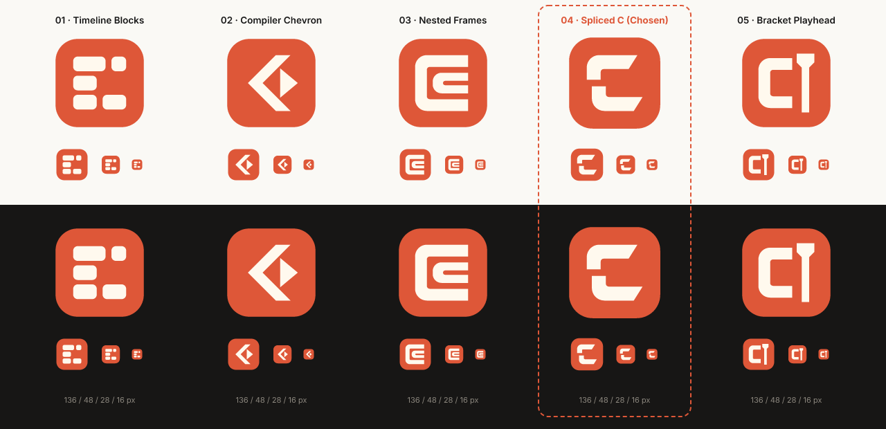

# Creator Compiler Brand Identity

Creator Compiler is a local desktop video studio for writing scripts, recording screen and camera, editing on a timeline, and exporting. The brand mark replaces the earlier rounded-C + play-triangle placeholder with a flat, geometric, two-colour **Spliced C** emblem built to hold up from a 16 px tab icon to a 1024 px macOS Dock icon.

## Explorations

Five distinct geometric directions were sketched as SVGs in [`explorations/`](./explorations/) and checked at 140 px, 48 px, 28 px, and 16 px on both light (`#FAF9F5`) and dark (`#1C1C1E`) surfaces:

| Direction | File | Concept & Assessment |
| --- | --- | --- |
| **01 · Timeline Blocks** | [`01-timeline-blocks.svg`](./explorations/01-timeline-blocks.svg) | Five staggered NLE clip blocks arranged in three tracks to spell a geometric C. Literal and warm at large sizes, but at 16 px the five small blocks begin to read like a list or grid icon rather than a distinctive lettermark. |
| **02 · Compiler Chevron** | [`02-compiler-chevron.svg`](./explorations/02-compiler-chevron.svg) | A `<` compiler angle bracket interlocked with a 45° playhead wedge. Crisp at 16 px, but stays close to the old play-triangle trope and leans more "developer arrow" than video studio. |
| **03 · Nested Frames** | [`03-nested-frames.svg`](./explorations/03-nested-frames.svg) | Concentric C-frames representing Screen + Camera / Creator + Compiler. The inner horizontal arms read too close to an "E" and the tight counterform closes up at 16 px. |
| **04 · Spliced C (Chosen)** | [`04-splice-blade.svg`](./explorations/04-splice-blade.svg) | A bold geometric C sliced cleanly across its waist (`4.5 u` kerf) and shifted along the cut (`3.5 u` horizontal offset) with parallel angled blade terminals. Unmistakably a **C** at every size including 16 px, evokes razor cuts (`⌘B`), staggered timeline tracks, and compiler precision with zero video/AI clichés. |
| **05 · Bracket Playhead** | [`05-bracket-playhead.svg`](./explorations/05-bracket-playhead.svg) | A geometric C-frame paired with a vertical NLE playhead blade in its opening. Clear metaphor, but reads closer to "CT" or "CI" at small sizes. |

## Why Spliced C (`04-splice-blade`) won

1. **Instant legibility at 16 px:** Two solid shapes separated by a generous `4.5 / 64` kerf remain crisp at 16 px in the app's `TabStrip`, browser favicons, and Windows taskbars — nothing blurs or collapses.
2. **Concept without cliché:** No play triangle, no camera lens, no clapperboard, no sparkles, and no gradient crutches. The horizontal splice cut and offset express video editing (blade cut + track alignment) and compilation (precision-joined halves) in one pure silhouette.
3. **Mathematical balance:** Both halves share an identical `9.5 u` stroke weight, `8.5 u` outer / `2 u` inner corner radii, parallel angled terminals (`dx = -6, dy = 9.5`), and exact centering at `(32, 32)` on the `64 × 64` viewBox.
4. **Native to the studio UI:** Uses only two flat tokens — `--cc-brand` (`#DE5738`) and `--cc-on-media` (`#FFF9EE` / `#FFFFFF`) — so `BrandMark.tsx` themes cleanly across light and dark modes and sits naturally beside the app's quiet Borumi/Heptabase surfaces.

## Palette

| Role | Static Asset | App CSS Token |
| --- | --- | --- |
| Brand vermilion tile | `#DE5738` | `var(--cc-brand)` |
| Mark ink | `#FFF9EE` | `var(--cc-on-media)` |
| Wordmark (light surface) | `#0A0A0A` | `var(--cc-text)` |
| Wordmark (dark surface) | `#F5F3EE` | `var(--cc-text)` |

## Deliverables

- **Mark:** [`logo.svg`](./logo.svg), [`logo.png`](./logo.png) (512 × 512 px)
- **Wordmarks:** [`logo-wordmark.svg`](./logo-wordmark.svg) (light), [`logo-wordmark-dark.svg`](./logo-wordmark-dark.svg) (dark)
- **GitHub social preview:** [`social-preview.png`](./social-preview.png) (1280 × 640 px)
- **React UI mark:** [`recorder/app/src/BrandMark.tsx`](../../recorder/app/src/BrandMark.tsx)
- **Favicons:** [`recorder/app/public/creator-compiler.svg`](../../recorder/app/public/creator-compiler.svg), [`recorder/site/favicon.svg`](../../recorder/site/favicon.svg)
- **Desktop app icons:** [`recorder/app/assets/icon.icns`](../../recorder/app/assets/icon.icns) (macOS Big Sur+ `824 × 824` squircle grid inside `1024 × 1024` with `100 px` margin and subtle dock shadow), [`recorder/app/assets/icon.iconset/`](../../recorder/app/assets/icon.iconset/), and [`recorder/app/assets/icon.ico`](../../recorder/app/assets/icon.ico) (16–256 px multi-size Windows icon).
