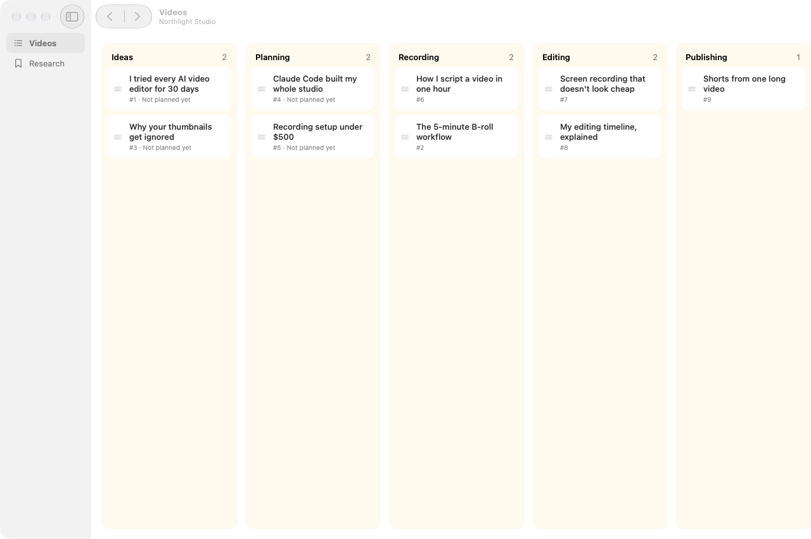

# Creator Compiler, native macOS shell (Exact spike)

A native macOS window for Creator Compiler, built with [Exact](https://github.com/expo/exact). It shows the
Video board and Research list, reading live data from the studio's local service. You drag cards between
lanes with AppKit's own drag, and the move is saved through the same API the web board uses. Opening a
card loads the existing editor inside the window, in a WKWebView.

This is a spike. [FEASIBILITY.md](FEASIBILITY.md) says what it proves and what it doesn't.



| What | Where |
|---|---|
| The view (Contract) | [`app.contract`](app.contract) |
| The data module, which talks to the service | [`app.ts`](app.ts) |
| Tests (web and macOS) | [`app.test.contract`](app.test.contract) |
| Brand colours | [`app.forma`](app.forma), from `docs/brand` (`#DE5738`, `#FFF9EE`) |
| A sample-data copy of the service | [`tools/demo-service.mjs`](tools/demo-service.mjs) |
| Screenshots taken with Exact's driver | [`docs/`](docs) |

## What it does

- **Videos**: six lanes (Ideas, Planning, Recording, Editing, Publishing, Published) from
  `GET /api/club/videos`. Hidden ideas ("later" and "skipped") are left out, as on the web board.
- **Drag a card** by its grip (≡) to another lane, or to a new place in its own lane. The drop sends
  `POST /api/club/videos/:id/move` with `{stage, beforeId}`, then reloads the board. If the service
  refuses the move, its error shows above the board.
- **Research**: the channel's Research cards from `GET /api/club/channel/research`, newest first. A link
  card opens in your browser.
- **Open a card**: pushes the existing web editor (`/#/video/<id>`) in an `iframe`. On macOS that is a
  WKWebView with its own persistent storage. The toolbar's share button opens the same page in your browser.
- **Which service**: the shell uses the first of these that answers `/api/ready` as Creator Compiler: the
  installed app (`127.0.0.1:4194`), then `npm run dev` (`127.0.0.1:4184`). It follows the service's current
  channel, the same one the Electron app shows. If neither answers, the window says Creator Compiler isn't running.

The Electron app is unchanged, and so is the service API. The shell uses only routes that already exist.

## Build and run

You need macOS, Xcode 27 (Swift 6.4+, the macOS 26 SDK), Rust through rustup, and Bun 1.4.2: the
versions Exact's README asks for. Exact isn't packaged, so you build it from a checkout:

```sh
git clone https://github.com/expo/exact ~/Developer/exact
cd ~/Developer/exact && bun scripts/exact.mjs setup     # one time, a few minutes
bun scripts/exact.mjs setup --check --platform macos    # what's missing, if anything
```

This app finds that checkout at `../../exact` from the main checkout of this repo
(`~/Developer/creatorclub/native` → `~/Developer/exact`). Anywhere else, set `EXACT=<path to the checkout>`.
This spike was built and tested against Exact `1aca3f837` (2026-11-24).

```sh
cd native
bun exact.mjs --help              # links .exact/checkout the first time
bun exact.mjs mac --run           # builds the .app and opens it (the first build takes minutes)
bun exact.mjs test macos          # the tests, on a native window
bun exact.mjs test web            # the same tests, in Chrome
```

Start the studio first (`npm run dev` at the repo root, or the installed app). Otherwise the window
says Creator Compiler isn't running. To open a card's editor from the dev service, build the web UI
once (`cd recorder/app && npx vite build`). The service then serves the editor itself on `:4184`.
`npm run dev` alone serves it from Vite on `:4183`, which the shell doesn't use.

### Try it on sample data

To drag cards around without touching your real channels, run a second copy of the service with a
sample channel on port 4199, and build the shell for it:

```sh
node native/tools/demo-service.mjs                    # repo root; seeds /tmp/cc-native-demo the first time
cd native && CLUB_URL=http://127.0.0.1:4199 bun exact.mjs mac --run
```

`CLUB_URL` is fixed at build. A build with it set talks only to that address. Exact's `net.fetch` grants
list the three loopback addresses the shell may reach, and nothing else.

### Drive it with Exact's agent

```sh
CLUB_URL=http://127.0.0.1:4199 bun exact.mjs agent macos --chrome platform \
  "resize 1280x800" "clock data" "tap grip-<video id> drag to list-recording" "clock data" \
  "screenshot .exact/board.png window"
```

The screenshots in `docs/` were taken this way (see [docs/README.md](docs/README.md)).

## The release .app

```sh
bun exact.mjs mac --release --json   # the last line names the .app, its signing identity and trust
```

This builds with `EXACT_UPDATE_TRUST=production`, signed with the Mac's Apple Development certificate.
It runs on the Mac that built it. It isn't a download for anyone else: that needs Exact's
`bun ~/Developer/exact/scripts/exact.mjs release <path>`, which signs with a **Developer ID Application**
certificate, uses the hardened runtime and notarizes with `notarytool` (keychain profile `exact-notary`).
This Mac has no Developer ID certificate, so the spike's release `.app` is locally signed only.

The release build ignores the agent driver, so the driver's screenshots come from the development build.
The release `.app` was launched separately (see `docs/README.md`).

## Layout of the code

- `app.contract`: routes `/` (Videos), `/video/:id` (the editor) and `/research`. A root `tablist`
  becomes the Mac sidebar. Each lane is a `list virtualized` in one `reorderGroup="videos"`, so Exact's
  host draws the lifted card and runs the drop natively. `navigationSplit="none"` keeps the board one
  wide page, instead of a list beside a "No Selection" detail.
- `app.ts`: plain `fetch` to the service, run by Hermes inside the app; there's no Node and no webview
  for the shell itself. Answers are reshaped into the small records the view declares (`Card`, `Tile`).
- `.exact/`, `target/`, `app.contract.d.ts` are generated and gitignored.
